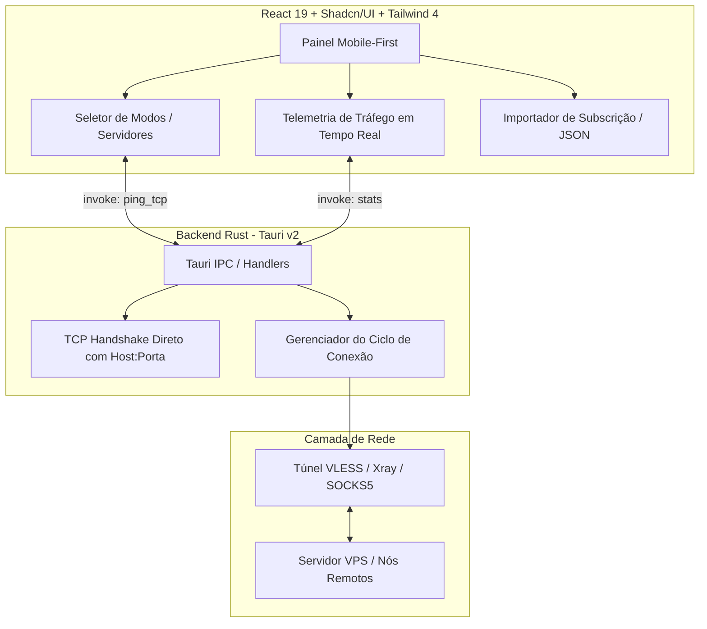

# 🛸 Rev Hunter Reborn (Mod / Re-implementation)

<div align="center">
  
  <br />
  <strong>Re-implementação moderna, aberta e ultra-leve do cliente Rev Hunter VPN</strong>
  <br />
  <em>Desenvolvido com Tauri v2, React 19, Tailwind CSS 4, Shadcn/UI e Rust</em>
  <br /><br />

  [](https://tauri.app/)
  [](https://react.dev/)
  [](https://vite.dev/)
  [](https://tailwindcss.com/)
  [](https://www.rust-lang.org/)
  [](LICENSE)
</div>

---

## ⚡ Visão Geral

O **Rev Hunter Reborn** foi projetado com o *"espírito de mod"* sobre a engenharia reversa do app original: mantém a identidade visual marcante (Cyber Dark Purple) e a compatibilidade com o protocolo **V2Ray / VLESS**, mas elimina completamente todas as barreiras e limitações impostas pela versão comercial.

### 🔥 Comparativo: Original vs. Reborn

| Recurso | Rev Hunter Original (APK) | Rev Hunter Reborn (Mod) |
|---|---|---|
| **Limite de Tempo** | 5 min iniciais + 2h por anúncio assistido | **Ilimitado (Conexão Contínua 24/7)** |
| **Monetização / Ads** | Appodeal, AdMob, ByteDance, VPAID | **Zero Anúncios / Zero Rastreadores** |
| **Login Google** | Obrigatório em diversos fluxos | **Desnecessário / Totalmente Local** |
| **Tamanho do App** | ~150 MB (APK inchado com SDKs) | **Ultra-leve (~15 MB no Android)** |
| **Servidores** | Fixos do provedor com restrições | **Híbrido: Presets + Subscrições VLESS / JSON** |
| **Ping & Latência** | Checagem básica | **TCP Ping Nativo em Rust com auto-sort** |

---

## 🏗️ Arquitetura do Sistema



---

## 🚀 Como Executar

### Pré-requisitos
* [Node.js](https://nodejs.org/) (versão 20+)
* [Rust](https://www.rust-lang.org/) & Cargo
* Dependências do Tauri para o seu sistema operacional

### 1. Clonar e Instalar Dependências
```bash
git clone https://github.com/marcuth/rev-hunter-client.git
cd rev-hunter-client
npm install
```

### 2. Modo Desenvolvimento

```bash
# Executar no navegador (apenas frontend Vite)
npm run dev

# Executar a aplicação desktop nativa (Tauri + Rust)
npm run tauri dev
```

---

## 📱 Compilando para Android (.APK)

O projeto está pronto para empacotamento Android através do Tauri v2:

```bash
# 1. Inicializa o template Android nativo (apenas na 1ª vez)
npm run tauri android init

# 2. Executa em emulador Android ou celular conectado via USB/ADB
npm run tauri android dev

# 3. Gera o arquivo final .apk assinado para distribuição
npm run tauri android build
```

O arquivo gerado estará localizado em:
`src-tauri/gen/android/app/build/outputs/apk/release/`

---

## 📁 Estrutura de Pastas

```text
rev-hunter-client/
├── public/
│   └── icon.png                  # Logo 3D oficial do Rev Hunter
├── src/
│   ├── components/
│   │   ├── ui/                   # Componentes base Shadcn (button, card, badge, typography)
│   │   ├── connection-button.tsx # Botão central de conexão com efeitos neon
│   │   ├── server-card.tsx       # Card interativo do servidor ativo com badge de ping
│   │   ├── server-list-drawer.tsx# Gaveta de seleção e busca de servidores
│   │   ├── traffic-stats.tsx     # Métricas de velocidade e cronômetro ilimitado
│   │   └── subscription-modal.tsx# Modal para importar links de subscrição
│   ├── schemas/
│   │   └── server.ts             # Validações estritas com Zod v4
│   ├── services/
│   │   └── vpn-service.ts        # Serviço de rede, subscrições e IPC com Rust
│   ├── types/
│   │   └── vpn.ts                # Interfaces TypeScript globais
│   ├── App.tsx                   # Layout principal
│   └── index.css                 # Tokens do tema Hunter Purple e Tailwind 4
└── src-tauri/
    ├── icons/                    # Conjunto completo de ícones para Windows, Android e macOS
    ├── src/
    │   ├── lib.rs                # Comandos Rust nativos (TCP ping, setup de ícone, túnel)
    │   └── main.rs
    ├── Cargo.toml
    └── tauri.conf.json           # Configuração do aplicativo
```

---

## 📜 Licença

Distribuído sob a licença **MIT**. Veja `LICENSE` para mais detalhes.
